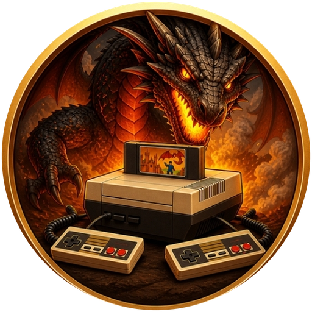

<p align="center"></p>

<h1 align="center">DragonNES</h1>
<p align="center">محاكي NES / Famicom احترافي للأندرويد بثيم التنين الناري</p>
<p align="center"><b>تطوير: مهند سات لنك</b></p>

---

## المميزات (النسخة 0.1)

| الميزة | التفاصيل |
|---|---|
| 🎮 محرك دقيق | FCEUmm عبر LibretroDroid (OpenGL ES 2) — يدعم مئات الـ mappers |
| 🎨 شريط الثيمات | شريط بالشاشة الرئيسية يغيّر ألوان الواجهة والأزرار بضغطة وحدة: لهب التنين، ذهبي ملكي، جمر، NES كلاسيك، فاميكوم، لهب أزرق… + ثيم مخصص |
| ⚡ بروفايل أداء تلقائي | يقرأ المعالج وكارت الشاشة والرام ويختار الفلتر المناسب |
| 📷 عدسة DSLR سينمائية | Shader خاص متعدد المراحل على كارت الشاشة: توهج Bloom، عمق مجال، انحراف ألوان العدسة، تعتيم الزوايا، حبيبات فلم متحركة، و5 تدرجات ألوان (طبيعي، سينمائي، بارد، فلم قديم، ألوان حية) — كل تأثير بشريط قوة خاص |
| ✨ HD ناعم (xBR) | Shader تكبير ذكي يرسم حواف البكسل ناعمة كأن اللعبة معاد رسمها، وينجمع ويه عدسة DSLR |
| 🎨 لوحات الألوان | NES Classic حي، ناعم HD، شاشة PVM، تلفزيون أصلي، Wavebeam، Digital Prime، Sony، Wii VC + محاكاة إشارة NTSC (Composite / S-Video / RGB) |
| 🖼️ فلاتر الصورة | بكسل، حاد، تنعيم CUT2، دقة فائقة CUT3، CRT، LCD، DSLR، HD |
| 📐 ملء الشاشة بالكامل | المحرك نفسه يرسم الصورة بقياس الشاشة الحقيقي (حتى منطقة النوتش) بدقة الشاشة الأصلية: أصلي، 4:3، 16:9، ملء الشاشة |
| 🔎 التعرف على الألعاب | بصمة CRC32 من قاعدة No-Intro، مع الهيدر iNES وبدونه (حتى الـ ROM بدون هيدر ينعرف) |
| 🖼️ الأغلفة | تحميل تلقائي من libretro-thumbnails |
| 🧩 جيتات أونلاين ذكية | Game Genie وأكواد خام (0025:63)، مطابقة تلقائية لاسم اللعبة ودمج كل النسخ، وبحث يدوي |
| 📴 بدون إنترنت | قاعدة أسماء كل ألعاب NES + أكثر من 2200 ملف جيتات مدمجة داخل التطبيق |
| 🌐 لعب أونلاين | لاعبين بموبايلين: على نفس الواي فاي/الهوتسبوت (يلكه المضيف تلقائياً) أو بالإنترنت بكود غرفة عبر سيرفر Cloudflare مجاني. مزامنة Lockstep حتمية + فحص تطابق تلقائي وإعادة مزامنة |
| 🎬 تسجيل فيديو | يسجل اللعبة بس (بدون الأزرار) ويه صوت اللعبة، بدقة لحد 1080p و60 إطار، مع عدّاد REC، ويحفظ بالمعرض Movies/DragonNES ويه زر مشاركة |
| 👥 لاعبين | جويستكين (لاعب 1 و 2) أو جويستك + أزرار اللمس، مع تبديل اللاعبين من القائمة |
| 🔥 Turbo | أزرار TA و TB على الشاشة، و X / Y بالجويستك، بثلاث سرعات |
| ↩️ استئناف تلقائي | يرجعك لنفس النقطة اللي طلعت منها |
| 💾 الحفظ | 4 خانات حفظ لحظي + حفظ تلقائي للـ SRAM (حفظ البطارية) |
| ⏪ الرجوع بالزمن | Rewind |
| ⏩ تسريع | ×2 أو ×3 حسب الجهاز |
| 🕹️ التحكم | أزرار لمس بتخطيط NES الأصلي مع اهتزاز وشفافية وحجم + دعم أيادي البلوتوث وربط الأزرار |

**الحد الأدنى:** أندرويد 7.0 (API 24) · المعماريات: arm64-v8a و armeabi-v7a
**الصيغ:** `.nes` `.unf` `.unif` وملفات `.zip`

## البناء

### تلقائياً على GitHub
كل `push` على فرع `main` يبني APK وينشره بصفحة **Releases**.

### محلياً
```bash
bash scripts/fetch_libretrodroid.sh  # يجيب LibretroDroid ويطبّق تعديلات DSLR وملء الشاشة
bash scripts/fetch_cores.sh     # يحمّل نواة FCEUmm لكل معمارية
bash scripts/fetch_db.sh        # يدمج قاعدة الأسماء والجيتات داخل التطبيق
./gradlew assembleRelease
```

### توقيع النسخة (اختياري)
أضف هذي الأسرار بإعدادات المستودع ← Secrets ← Actions:
`SIGNING_KEYSTORE_BASE64`, `SIGNING_STORE_PASSWORD`, `SIGNING_KEY_ALIAS`, `SIGNING_KEY_PASSWORD`.
بدونها يتوقّع بمفتاح debug (يكفي للتجربة).

## هيكل المشروع
```
app/src/main/java/com/dragonnes/emu/
├── MainActivity.kt            الشاشة الرئيسية
├── data/                      المكتبة، قاعدة البيانات (CRC)، الجيتات، الإعدادات
├── device/DeviceProfiler.kt   فحص المعالج وكارت الشاشة واختيار الفلتر
├── game/                      شاشة اللعب، أزرار اللمس، Turbo، قائمة الإيقاف
└── ui/                        الثيم، شريط الثيمات، المكتبة، الإعدادات
```

## سيرفر اللعب أونلاين (مرة وحدة)
1. سوّي حساب مجاني على [Cloudflare](https://dash.cloudflare.com/sign-up).
2. سوّي API Token من قالب **Edit Cloudflare Workers**، وانسخ **Account ID**.
3. بالمستودع ← Settings ← Secrets and variables ← Actions أضف: `CLOUDFLARE_API_TOKEN` و `CLOUDFLARE_ACCOUNT_ID`.
4. شغّل **Deploy online relay** من تبويب Actions، وانسخ رابط `https://dragonnes-relay.….workers.dev`.
5. أضف متغير (Variables) اسمه `RELAY_URL` بهذا الرابط، والنسخة الجاية من التطبيق تشتغل أونلاين.

## الخطة القادمة
- [ ] Famicom Disk System (FDS)
- [ ] لاعبين اثنين على نفس الجهاز
- [ ] محرر تخطيط أزرار اللمس بالسحب
- [ ] صورة مصغرة لكل خانة حفظ
- [ ] RetroAchievements
- [ ] مزامنة الحفظ مع Google Drive

## الترخيص والملاحظات القانونية
- الكود مرخّص **GPL-3.0-or-later** (LibretroDroid مرخصة GPLv3، و FCEUmm مرخصة GPLv2+).
- التطبيق **لا يحتوي على أي ألعاب**. المستخدم يضيف نسخه الخاصة بنفسه.
- Nintendo و NES و Famicom علامات تجارية لشركة Nintendo، والمشروع غير مرتبط بها.

## شكر
[LibretroDroid](https://github.com/Swordfish90/LibretroDroid) · [FCEUmm](https://github.com/libretro/libretro-fceumm) · [libretro-database](https://github.com/libretro/libretro-database) · [libretro-thumbnails](https://thumbnails.libretro.com)
